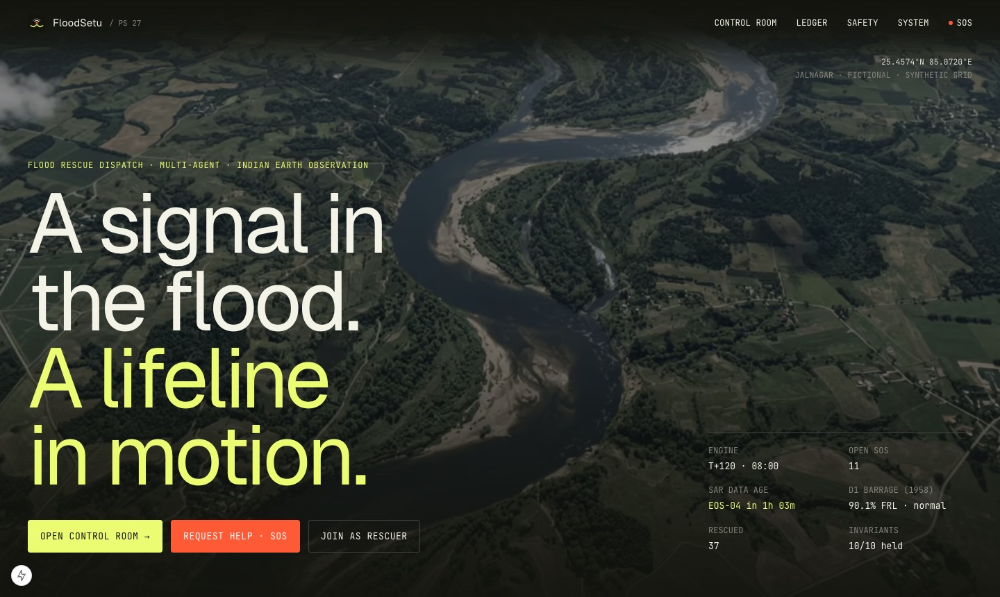
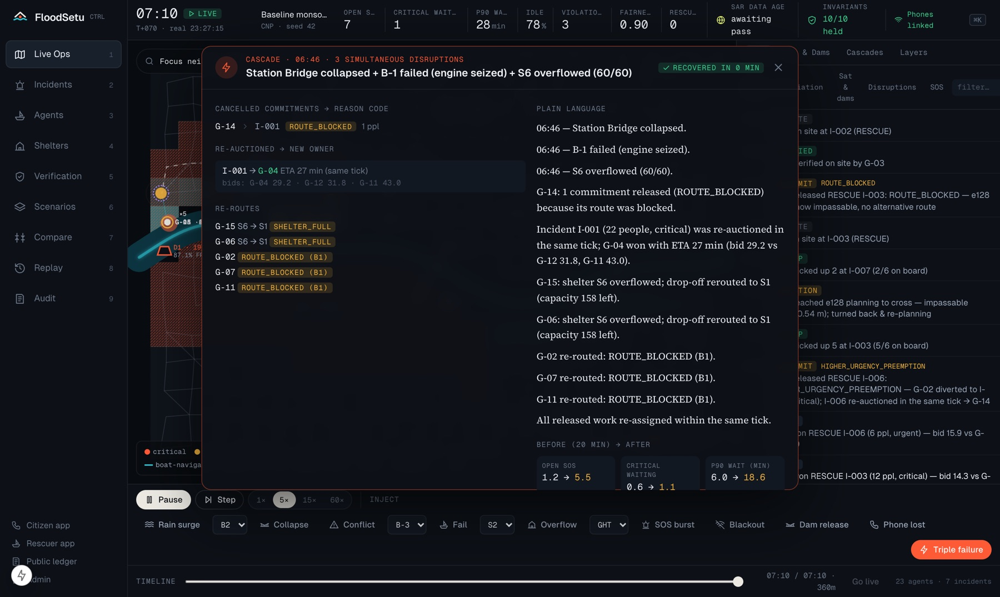
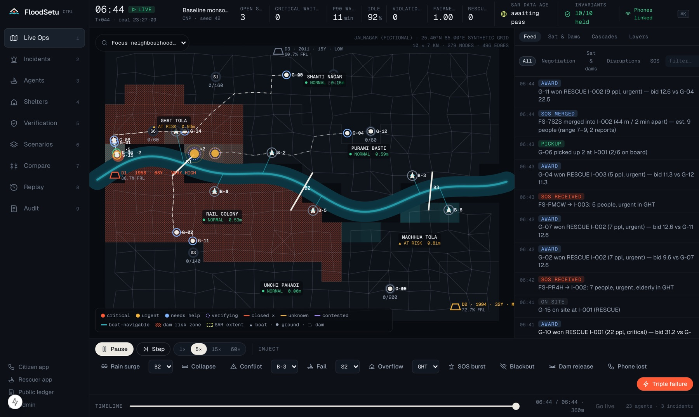
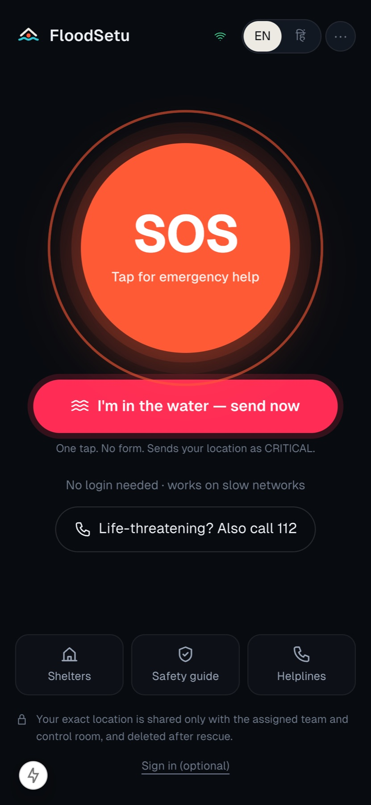
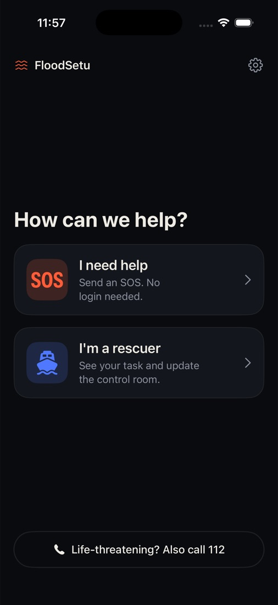
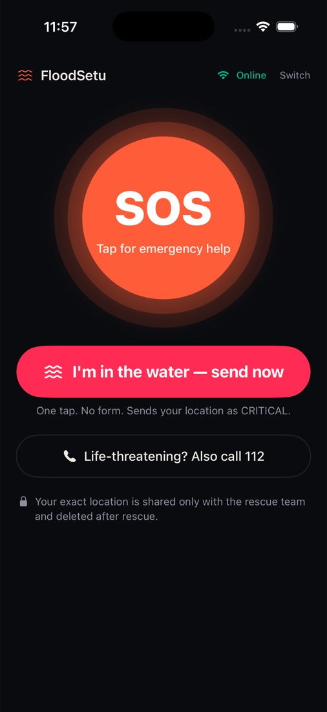
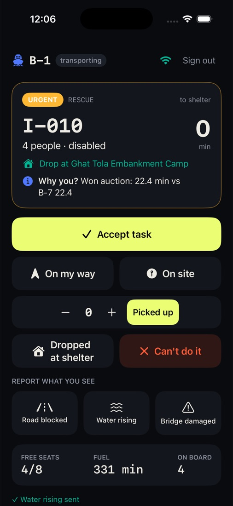
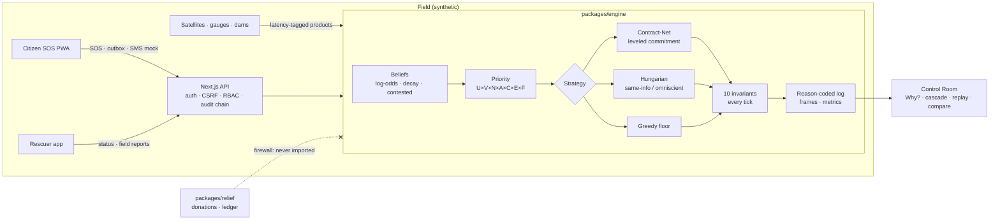

<div align="center">

# FloodSetu

### When the water rises, every second negotiates.

**Multi-agent flood rescue dispatch** that runs decentralised Contract-Net negotiation and a centralised optimiser on the same seeded flood, then shows you honestly where each one wins.

`Code-E-Manipal 2.0` · `Track 06 — Multi-Agent Systems / Logistics` · `PS 27`


<br/>



<sub>The landing page is not a video. A real engine instance runs in a Web Worker behind it: the "10/10 held" and "SAR data age" readouts are live.</sub>

</div>

---

## Contents

- [The brief, at a glance](#the-brief-at-a-glance)
- [1 · Implementation challenge](#1--implementation-challenge)
- [2 · Evaluation and failure tests](#2--evaluation-and-failure-tests)
- [3 · Stretch: the triple failure](#3--stretch-the-triple-failure)
- [4 · Deliverables: the minimum prototype](#4--deliverables-the-minimum-prototype)
- [5 · Public-sector relevance](#5--public-sector-relevance)
- [Beyond the brief: what the judges asked for](#beyond-the-brief-what-the-judges-asked-for)
- [Honest results](#honest-results)
- [Run it in three commands](#run-it-in-three-commands)
- [Architecture](#architecture)
- [Docs and limitations](#docs-and-limitations)

---

## The brief, at a glance

Every line of the problem statement, mapped to the code and the evidence that proves it.

| The brief asks for | What FloodSetu does | Proof |
|---|---|---|
| Dynamic re-planning over a changing road/water graph | 279-node, 496-edge graph whose passability is re-computed every minute from water depth. Boats and ground teams see different graphs. | [`sim.ts`](packages/engine/src/sim.ts), [`graph.ts`](packages/engine/src/graph.ts) |
| Uncertainty-tagged reports | Every report carries a source and a confidence. They are fused as log-odds beliefs that decay over time, and conflicting reports mark an edge **contested**. | [`beliefs.ts`](packages/engine/src/beliefs.ts) |
| Capacity constraints | Boat seats, shelter beds with confirmed reservations, skills and modes. All are enforced as invariants. | [`invariants.ts`](packages/engine/src/invariants.ts) |
| Fairness criteria | A neighbourhood-lag term **F** in the priority formula, measured with Jain and Gini indices and worst-neighbourhood P90 wait | [`priority.ts`](packages/engine/src/priority.ts), [`metrics.ts`](packages/engine/src/metrics.ts) |
| Explicit safety invariants | **10 invariants**, checked at the end of **every tick** for **every strategy**. Violations are counted, never swallowed. | [`invariants.ts`](packages/engine/src/invariants.ts) |
| Decentralised vs centralised | **Contract-Net with leveled commitment** vs a **Hungarian optimiser** (same-information *and* omniscient), plus a greedy floor | [`strategies.ts`](packages/engine/src/strategies.ts), [`hungarian.ts`](packages/engine/src/hungarian.ts) |
| Time to service, unmet requests, idle time, route violations, fairness, recovery after contradictions | All six, plus 12 more, in **140 seeded runs** | [`bench/RESULTS.md`](bench/RESULTS.md) |
| Stretch: simultaneous bridge + boat + shelter failure | One-click **Triple failure**: cancelled commitments with reason codes, the re-auction bid table, and a plain-language "why" | [Screenshot ↓](#3--stretch-the-triple-failure) |
| Time-stepped sim, injected events, assignment log, reroute explanation, after-action replay | 1 tick = 1 minute and deterministic per seed. There are 16 injectable event types, a reason-coded event log, a **Why?** drawer and a replay scrubber. | [`scenarios/`](scenarios), Control Room |
| Synthetic data only | **Jalnagar** is a fictional town. No live feeds, no real victims, no real payments. | [`world.ts`](packages/engine/src/world.ts) |

---

## 1 · Implementation challenge

> *"Implement dynamic re-planning over a changing road/water graph, with uncertainty-tagged reports, capacity constraints, fairness criteria and explicit safety invariants. Compare decentralised negotiation with a centralised baseline."*

### A world that keeps changing

Jalnagar has six neighbourhoods on both banks of a river: Ghat Tola, Machhua Tola, Purani Basti, Rail Colony, Shanti Nagar and Unchi Pahadi. It has 279 nodes, 496 edges, three bridges, six ghats and six shelters. Water levels follow a per-neighbourhood flood curve. Each tick, each edge's depth is compared with each agent type's limits:

- **Ground teams** (15) need roads shallower than wading depth, and bridges that are standing.
- **Boats** (8) need enough draft, and can't cross dry land. They reach dry shelters through **landing drop nodes** at the ghats.
- A task's **mode** (boat or ground) is decided by *reachability* in the current graph, so it switches as the water moves, not once at creation.

Because the graph changes under the agents, **every agent re-plans its route every tick** against *its own belief* of the graph. When a planned edge turns impassable, it turns back and re-plans, and the log says exactly why.

### Three layers of truth

| Layer | Who sees it | Used for |
|---|---|---|
| **Truth** | Only the simulator, and the omniscient baseline | Scoring route violations and outcomes |
| **Common operating picture** | The control room | The centralised baseline's same-information mode |
| **Per-agent beliefs** | Each unit, from its own sensing plus the reports it received | Contract-Net bids and routing |

### Uncertainty-tagged reports

Each report is `{edge, claim, source, confidence}`. Sources have different reliability: a sensor is 0.95, a rescuer 0.90, the control room 0.85 and a citizen 0.65. A report moves the edge's **log-odds** by reliability × confidence, and evidence **decays back toward the prior** as it ages. When strong reports disagree (a citizen says *open* while a rescuer says *collapsed*), the edge becomes **contested**:

- ground teams avoid it, and boats pay ×3 to use it;
- a **VERIFY** task is auctioned to a verification-skilled team;
- we measure **contradiction resolution time**, **plan stabilisation time** and **wasted trips**.

### Capacity constraints

Boat seats (`onboard ≤ capacity`), shelter beds (drop-off needs a **confirmed reservation**, so there is no over-booking), skill matching (`first_aid`, `verification`, `supplies`, `logistics`) and mode matching (boat vs ground). Each one is also a safety invariant, so a breach can't go unnoticed.

### Fairness: in the score, not just in the report

Priority is a single inspectable product. There are no hidden weights:

```text
Priority = U × V × N × A × C × E × F
           │   │   │   │   │   │   └ Fairness: boost for neighbourhoods whose mean wait lags the town
           │   │   │   │   │   └ Escalation: control-room escalation after MAX_WAIT
           │   │   │   │   └ Confidence: verification state (critical SOS ignore it entirely)
           │   │   │   └ Aging: grows with wait time, so nothing starves
           │   │   └ Number of people (log-scaled)
           │   └ Vulnerability: elderly, child, pregnant, disabled, medical, injured, in-water, dam-risk zone, phone lost
           └ Urgency: critical / urgent / needs-help
```

> [!IMPORTANT]
> The priority input type has **no money, donation, campaign or media fields**. A `@ts-expect-error` test proves you can't add one. Donations can never buy rescue priority.

### Ten safety invariants, checked every tick

| # | Invariant |
|---|---|
| 1 | A boat never exceeds its capacity |
| 2 | No agent is routed through an edge it believes closed or impassable for its type |
| 3 | No task is assigned to an agent lacking the required mode or skill |
| 4 | No transfer to a full shelter; drop-off requires a confirmed reservation |
| 5 | A failed agent's commitments are released and re-announced **in the same tick** |
| 6 | No request waits beyond `MAX_WAIT` (30 / 90 / 240 min) without escalation |
| 7 | Life-threatening SOS are dispatched **even while verification is pending** |
| 8 | Donation data never influences dispatch (architecture test + ESLint rule) |
| 9 | Every assignment, decommit and override has a logged reason |
| 10 | A request whose phone goes silent keeps its last-known location and is critical + escalated in the same tick |

The suite asserts all of them for **7 scenarios × 4 strategies**, plus fast-check property tests over random seeds.

### Decentralised vs centralised: same world, same seed, four strategies

| Strategy | How it decides |
|---|---|
| **CNP (decentralised)** | Each task is *announced*. Units that can reach it *bid* their ETA-based cost, and the best (task, bid) pair by `priority / (1 + bid/20)` is *awarded* first. **Leveled commitment:** a unit drops a task only for a better offer that beats an 8-minute decommit penalty. Strictly more urgent work can **pre-empt**. |
| **Central, same information** | A global **Hungarian assignment** re-solved every tick over the control room's fused picture: what a perfect central dispatcher with the same information would do |
| **Central, omniscient** | The same solver, but reading ground truth. It's the **upper bound**, and it shows what perfect sensing would buy. |
| **Greedy floor** | Nearest-first and urgency-blind. It's the "no algorithm" baseline. |

---

## 2 · Evaluation and failure tests

> *"Measure time to service, unmet requests, resource idle time, route violations, fairness across neighbourhoods and recovery after contradictory updates."*

The `pnpm bench` command runs **7 scenarios × 5 seeds × 4 strategies = 140 runs**. It writes [`bench/RESULTS.md`](bench/RESULTS.md) and the in-app **Compare** view.

| Required metric | How it's measured | CNP | Central | Omniscient | Greedy |
|---|---|---|---|---|---|
| **Time to service** | SOS creation → pickup, mean (min) | 49.6 | 49.5 | 41.5 | **45.5** |
| ↳ critical only | Same, critical requests (min) | 28.8 | **27.5** | 22.5 | 43.9 |
| **Unmet requests** | Still open at end of run | 17.5 | 17.9 | 13.7 | **13.0** |
| **Resource idle time** | Idle **while demand is open** (%) | **22.2** | 26.1 | 26.7 | 25.4 |
| **Route violations** | Unit reached an edge that was *truly* impassable | 5.9 | 6.2 | 0 | **5.4** |
| **Fairness** | Jain index over neighbourhood waits (↑) | 0.88 | 0.85 | 0.90 | **0.89** |
| **Recovery after contradiction** | Time until the plan stops churning (min) | 2.4 | **2.0** | 0 | 4.0 |
| Cascade recovery | All released work re-assigned (min) | **10.3** | 10.5 | 2.4 | 27.4 |
| Safety invariant violations | Across all 140 runs | **0** | **0** | **0** | **0** |

<sub>Omniscient is an upper bound, not a competitor. Bold marks the best achievable strategy. Full tables with ± std per scenario are in <a href="bench/RESULTS.md">bench/RESULTS.md</a>.</sub>

### Failure scenarios we test on purpose

| Scenario | What breaks |
|---|---|
| `baseline-monsoon` | Rising water, a steady SOS stream |
| `sos-surge` | Bursts of SOS, duplicates and same-building reports, which must be merged, not double-counted |
| `contradiction` | A citizen says a bridge is open, a rescuer says it collapsed, and a sensor disagrees with both |
| `blackout` | A neighbourhood loses its network for 160 min, so only satellites see it |
| `fraud-mix` | False and inflated reports are mixed in. They are flagged and down-weighted, **never** rejected if critical. |
| `dam-release` | An old upstream barrage releases water, and its downstream zone floods fast |
| `triple-failure` | The stretch goal: bridge, boat and shelter fail in the same minute |

---

## 3 · Stretch: the triple failure

> *"Trigger simultaneous bridge closure, boat failure and shelter overflow; show which commitments are cancelled, who is re-assigned and why."*

Press **Triple failure**, or **T**, in the Control Room. In one tick the busiest bridge collapses, the busiest boat fails **with people on board**, and the most-reserved shelter overflows.



The cascade panel answers all three questions in the brief:

- **Which commitments were cancelled.** Each one is listed with a machine **reason code**: `ROUTE_BLOCKED`, `RESOURCE_FAILURE`, `SHELTER_FULL`, `HIGHER_URGENCY_PREEMPTION`, `INFO_CONTRADICTED`, `BETTER_OFFER`, …
- **Who was re-assigned.** The same-tick re-auction shows the **full bid table**, for example *I-001 → G-04, ETA 27 min (bids: G-04 29.2 · G-12 31.8 · G-11 43.0)*.
- **Why.** A deterministic plain-language explanation is built only from the structured log, so it can never invent a fact. Before→after KPIs and **time to full recovery** are shown alongside.

The people stranded on the failed boat aren't lost in the shuffle. They become a **new tracked critical incident** (cause `STRANDED`). Invariant 5 proves every released commitment was re-announced in the same tick.

---

## 4 · Deliverables: the minimum prototype

> *"Deliver a time-stepped simulation, injected events, assignment log, reroute explanation and after-action replay. Use synthetic locations and scenarios rather than live operational feeds."*



| Deliverable | Where |
|---|---|
| ⏱ **Time-stepped simulation** | 1 tick = 1 simulated minute and fully deterministic per seed. Run it in a Web Worker in the browser (1×/5×/15×/60×, pause, step) or headless with `pnpm sim`. |
| 💥 **Injected events** | 16 event types, from the Control Room dock or scenario JSON: rain surge, edge close/open, bridge collapse, agent failure/recovery, shelter overflow, SOS and SOS bursts, conflicting reports, blackout, control override (pin/veto), triple failure, dam release/breach, device lost |
| 📜 **Assignment log** | A live negotiation feed (`ANNOUNCE → BID → AWARD → DECOMMIT`). Every entry carries a reason (invariant 9), and the **Audit** view is hash-chained. |
| 🧭 **Reroute explanation** | **Why?** drawer on any assignment: the bid table, the priority breakdown `U×V×N×A×C×E×F` and the constraints that excluded other units. Reroutes are logged with the edge and cause (*"reached e128 planning to cross — impassable (0.54 m); turned back & re-planning"*). |
| ⏪ **After-action replay** | Every tick's frame is recorded, so you can drag the timeline scrubber back through the whole incident or replay a cascade |
| 🧪 **Synthetic only** | Jalnagar is fictional. Satellites, gauges, dams and SOS are all simulated, and every external service has an offline mock. |

---

## 5 · Public-sector relevance

Built for **disaster-management authorities** (NDMA/SDMA/DDMA control rooms), **fire and emergency services** and **NDRF/SDRF boat teams**:

- **Control Room**: one screen for incidents, units, shelters, verification queue, satellite and dam status, and a ⌘K command palette.
- **Citizen SOS app**: no login, works on 2G and offline (IndexedDB outbox), an SMS fallback, and a **"I'm in the water"** one-tap button.
- **Rescuer phone app**: OTP sign-in, a "Why you?" panel for every task, one-tap status updates and field reports that feed the belief layer.
- **Relief and donations**: a hash-chained **public ledger** anyone can verify, with fraud flags. It is **firewalled** from dispatch in code, tests and lint.
- **Aarogya Setu-style privacy**: rotating pseudonyms, and exact location shared only with the assigned team and purged after rescue.

<table>
<tr>
<td width="38%"></td>
<td>

**The citizen side, built for the worst phone on the worst network**

- Payload is about 200 bytes and retries automatically.
- **I'm in the water** sends a CRITICAL SOS with GPS in one tap, with no form.
- If the phone **drowns** after sending, a 90 s heartbeat watchdog marks it lost. The request stays at its last-known location and becomes critical + escalated (invariant 10). The alternate number gets a call.
- **13 languages.** English is the default, Hindi is one tap away, and the regional language is *suggested* from GPS → state.
- Fallback to `112` is always visible.

</td>
</tr>
</table>

### Native iPhone app

A simple SwiftUI app in [`apps/ios`](apps/ios) with two modes, **I need help** and **I'm a rescuer**. It calls the same API, so the Control Room sees iPhone SOS and crew acknowledgements live.

<table>
<tr>
<td width="33%"></td>
<td width="33%"></td>
<td width="33%"></td>
</tr>
</table>

---

## Beyond the brief: what the judges asked for

| Judge's question | What we built |
|---|---|
| *"Which satellite data? Use Indian satellites, with real-time latency."* | A simulated Indian constellation: **EOS-04 (RISAT-1A)** C-band SAR (about 110 min to product), **NISAR** S-band SAR (about 95 min), **INSAT-3DS/3DR** rain nowcasts (every 15 min, about 30 min latency), and **Resourcesat-2A** optical, which is shown being **rejected for cloud**. Each product carries *acquired* and *available* times. The UI shows live **data age**, and fusion is last-writer-wins by *observation* time, so an old satellite pass never overrides fresher field data. |
| *"Include dam data: how old is the dam? Mark the area high-risk."* | A dam register with NRLD-style fields. **D1 is a 1958 barrage** (very high risk), D2 dates from 1994 and D3 from 2011. Risk is an explainable age + condition + hazard score. Downstream zones are hatched on the map and add a priority term. `DAM_RELEASE` and `DAM_BREACH` events drive a reservoir model. |
| *"What if someone's phone is drowning?"* | A one-tap in-water SOS, a heartbeat watchdog, the `DEVICE_LOST` event, **invariant 10**, an alternate contact, a battery-low early warning, and 17 answered questions in [`docs/JUDGE_QA.md`](docs/JUDGE_QA.md). |
| *"India has many languages."* | 13 languages: English (default), हिन्दी, বাংলা, मराठी, తెలుగు, தமிழ், ગુજરાતી, ಕನ್ನಡ, മലയാളം, ਪੰਜਾਬੀ, ଓଡ଼ିଆ, অসমীয়া and اردو (RTL). The state's language is suggested from location and never forced, and an unknown language code can never block an SOS. |

---

## Honest results

> [!NOTE]
> We set out to show negotiation beats central planning. **The data says it's closer than that**, and we publish it as-is.

- **CNP and same-information central are within 0.1 min on mean time to service** (49.6 vs 49.5). CNP wins **4 of 7** scenarios: baseline, blackout, contradiction and triple failure.
- **Central is about 5% faster on critical cases** (27.5 vs 28.8 min). It also wins *fraud-mix*: CNP's per-incident auctions are easier to lure with false reports before verification.
- **CNP keeps units busier** (22% vs 26% idle while demand is open) and **churns less** (1.26 vs 2.0 decommits per task) because of leveled commitment.
- **Greedy has the best plain mean but is 52% slower on critical cases** (43.9 min). Urgency-blindness looks efficient until you look at who waited.
- **Omniscient vs CNP is the price of partial information**: 41.5 vs 49.6 min, and 0 vs 5.9 route violations. That gap is what better sensing and comms would buy.

Things we tried that the data rejected, such as an extra queue slot for critical tasks, are logged in [`docs/DECISIONS.md`](docs/DECISIONS.md).

---

## Run it in three commands

```bash
pnpm install
```
```bash
pnpm dev
```
Then open **http://localhost:3000**. Everything runs offline: mock OTP, mock SMS, no map tiles, no external APIs.

| URL | What |
|---|---|
| `/` | Immersive landing, driven by a live engine in a Web Worker |
| `/control` | **Control Room**: live map, negotiation feed, Why?, cascades, compare, replay, audit, ⌘K |
| `/sos` | Citizen SOS: guest, 13 languages, offline outbox, in-water button |
| `/rescuer` | Rescuer phone. Demo: tap a unit, or OTP `9000000001` → B-1 |
| `/relief` | Public transparency ledger. Try **Verify ledger** → **Simulate tampering** |
| `/admin` | Audit chain, fraud flags, roles |
| `/awareness` · `/dev/inbox` | Safety guide · mock SMS inbox |
| `apps/ios` | Native iPhone app (victim + rescuer). Open `FloodSetu.xcodeproj` and press Run |

### Evidence commands

```bash
pnpm test
```
102 unit, property, architecture and i18n tests (vitest + fast-check).

```bash
pnpm bench
```
140 seeded runs → `bench/RESULTS.md`.

```bash
pnpm e2e
```
Playwright: guest SOS, live rescuer accept, triple failure, Why?, drowning flow, ledger tamper check.

```bash
pnpm sim scenarios/triple-failure.json cnp
```
A headless single run that prints the metrics JSON.

---

## Architecture



```text
packages/engine    sim · beliefs · earth (satellites, dams) · CNP / Hungarian / greedy · invariants · metrics · replay
packages/dispatch  SOS intake · OTP · rotating pseudonyms · audit chain · rescue→relief summary
packages/relief    campaigns · inventory · hash-chained ledger · fraud flags     (never imported by the rescue side)
packages/shared    sha256/hmac · hash chain · the ONE contract: AffectedAreaSummary (k ≥ 5)
apps/web           Next.js 15 · React 19 · Web-Worker engine · Canvas2D map · R3F landing
```

**The donation firewall is enforced four ways:** an architecture test, an ESLint `no-restricted-imports` rule, separate data stores, and a priority type with no money fields.

---

## Docs and limitations

| Doc | What's inside |
|---|---|
| [`docs/RESEARCH.md`](docs/RESEARCH.md) | CNP, leveled commitment, Hungarian, belief fusion, and Indian flood-response context |
| [`docs/ARCHITECTURE.md`](docs/ARCHITECTURE.md) | Diagrams, data flow, live bridge, security model |
| [`docs/DECISIONS.md`](docs/DECISIONS.md) | 39 logged decisions, including the ones the data overruled |
| [`docs/DEMO.md`](docs/DEMO.md) | 3-minute judge demo script |
| [`docs/JUDGE_QA.md`](docs/JUDGE_QA.md) | "What if the phone drowns?" and other questions, each marked Built / Mocked / Proposed |
| [`docs/LIMITATIONS.md`](docs/LIMITATIONS.md) | What isn't real yet, stated plainly |
| [`bench/RESULTS.md`](bench/RESULTS.md) | Full benchmark tables, per scenario, with ± std |

> [!CAUTION]
> **Jalnagar is a fictional town. All data is synthetic.** There are no real victims, no live operational feeds and no real payments. Satellite, SMS, OTP and IVR services are offline mocks. Regional translations need native-speaker review before real-world use.

<div align="center">
<br/>
<sub>Built in 36 hours for Code-E-Manipal 2.0 · <b>Build the proof · Test failure cases · Show your evidence</b></sub>
</div>
