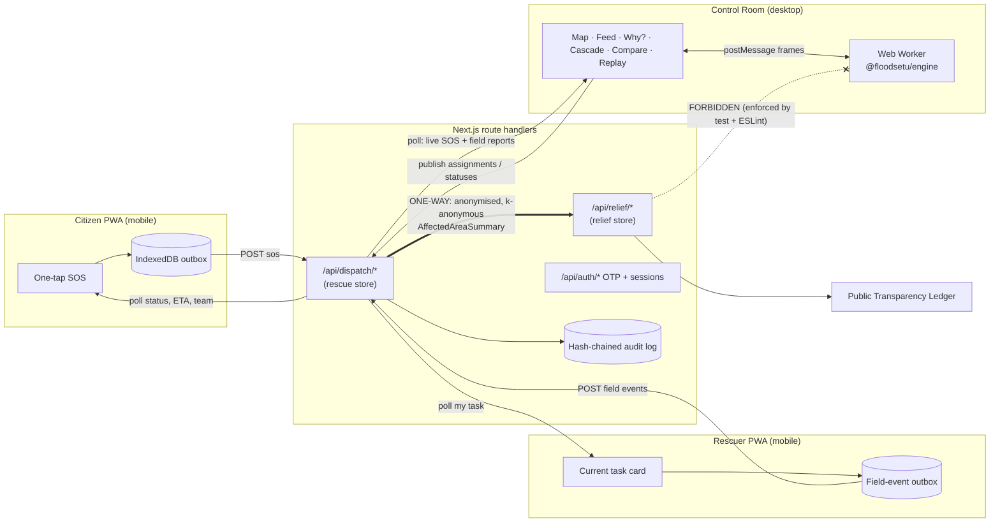

# FloodSetu — Architecture

## Monorepo map

```
apps/web                Next.js 15 (App Router): landing, control room, citizen, rescuer, relief, admin
packages/engine         Pure-TS simulation: world graph, agents, beliefs, CNP, baselines, metrics, invariants
packages/dispatch       Rescue domain: SOS intake, request IDs, dedup, risk score, OTP, pseudonymous IDs, audit chain
packages/relief         Relief domain: campaigns, collection points, inventory flow, hash-chained ledger, fraud flags
packages/shared         Neutral utilities + the ONE cross-module contract (AffectedAreaSummary) + hash chain
packages/ui             Design tokens (tokens.css) + Tailwind v4 theme
scenarios/*.json        Seeded synthetic scenarios
scripts/bench.ts        N seeds × M scenarios × 4 strategies → bench/results.{json,csv,md}
tests/                  Architecture isolation test
```

## System diagram



## The firewall (Section 3)
- `@floodsetu/engine` and `@floodsetu/dispatch` **must not import** `@floodsetu/relief`, and must not list it as a dependency.
  - Enforced by `tests/architecture.test.ts`, which scans every source file and `package.json`, and fails on any import of relief from the rescue side.
  - Also enforced by the ESLint `no-restricted-imports` rule in `eslint.config.mjs`.
- Separate persistence: `.data/dispatch.json` vs `.data/relief.json`, with separate route trees (`/api/dispatch`, `/api/relief`).
- The **only** flow is rescue → relief. `dispatch.summariseAffectedAreas()` produces the `AffectedAreaSummary[]` defined in `@floodsetu/shared`: neighbourhood-level only, with counts suppressed below k = 5. The relief module consumes it to show verified needs.
- Engine scoring code (`priority.ts`) receives no money-related fields. Its inputs are typed so a donation field cannot reach it.

## Engine tick (1 tick = 1 simulated minute)

```mermaid
sequenceDiagram
  participant E as Event queue
  participant W as World (truth)
  participant N as Network (latency/loss/blackout)
  participant A as Agents (beliefs)
  participant C as COP (control-room fusion)
  participant S as Strategy (CNP | Central | Greedy)
  E->>W: 1. apply injected events (closures, failures, SOS, reports)
  W->>W: 2. flood dynamics (water level per neighbourhood)
  A->>W: 3. observe local truth (edges at current node)
  A->>N: 4. send reports + heartbeats (dropped in blackout → local outbox)
  N->>C: 5. deliver due messages → fuse beliefs (log-odds), detect contradictions
  C->>C: 6. SOS dedup → incidents → tasks (+VERIFY tasks for contested edges)
  S->>A: 7. MONITOR: invalid commitments → decommit(reason) → released
  S->>A: 8. ALLOCATE: announce/bid/award (CNP) or Hungarian (central) — same tick
  A->>W: 9. move along planned routes; attempt edges (violations vs truth)
  W->>W: 10. pickups, reservations, drop-offs, completions
  W->>W: 11. invariants check + metrics accumulate + frame snapshot
```

## Information model
| Layer | Who holds it | Contents |
|---|---|---|
| **Truth** | World | edge closures, true water level per neighbourhood, true agent positions |
| **COP** | Control room | fused edge beliefs (log-odds + contested flag + sources), last-known agent positions/statuses, water-level estimates from gauges |
| **Agent belief** | Each agent | its own observations + the last COP broadcast it received (missed during blackout) |

The **omniscient** strategy replaces every belief store with truth and makes comms perfect. That makes it the upper bound.

## Event sourcing
Every state change is appended to `state.log` as a typed `SimEvent`, e.g. `SOS_RECEIVED`, `ANNOUNCE`, `BID`, `AWARD`, `DECOMMIT{reason}`, `REROUTE`, `VIOLATION`, `INVARIANT`, or `ESCALATED`. A compact render **frame** is captured every tick. Replay scrubs frames, and the event log feeds the assignment log, the Why? drawer, and the cascade panel. A test checks determinism: the same seed and the same injected events give an identical log hash.

## Live bridge (real phones ↔ simulation)
The control-room browser is the dispatch "brain" (the worker). Real SOS from phones land in the dispatch store. The control room polls every 2 s and injects them as `SOS` events (source: citizen) into the running simulation, then publishes assignment and ETA back. A rescuer phone signs in as a fleet unit (e.g. `B-1`), sees that unit's live commitment, and posts field events. Those become rescuer-sourced belief reports in the simulation.
